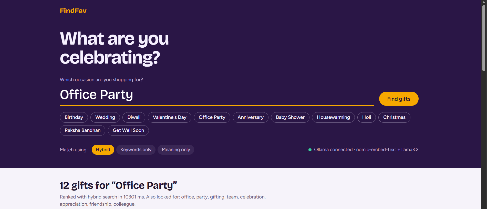
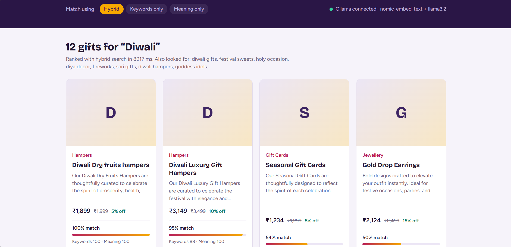
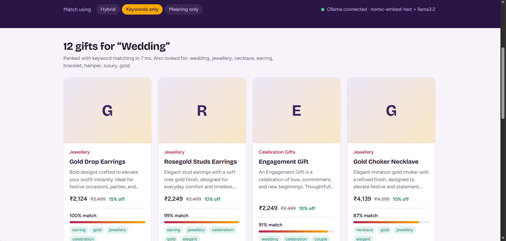

# FindFav – Occasion-Based Product Recommender

Type an occasion ("Diwali", "Valentine's Day", "office party", "mum's birthday") and get a ranked
grid of matching products from the catalog, right below the input.

* **Frontend** – plain HTML / CSS / JavaScript (no build step), calls the API with `fetch`
* **Backend** – Python + **FastAPI**
* **Recommendation engine** – **hybrid**: keyword / rule-based matching **+** Ollama embeddings
  ranked by **cosine similarity**, with optional Ollama LLM query expansion

---

## Quick start

### 1. Install Ollama and pull two small models

```bash
# https://ollama.com/download
ollama pull nomic-embed-text   # embeddings (~270 MB)
ollama pull llama3.2           # optional: query expansion / "is this a real occasion?" check
```

Ollama is **optional at runtime**: if it isn't running, the app falls back to keyword matching
and the UI says so.

### 2. Run the app

```bash
python -m venv .venv && source .venv/bin/activate      # Windows: .venv\Scripts\activate
pip install -r requirements.txt
uvicorn backend.app.main:app --port 8000 --reload
```

Open **http://localhost:8000** – FastAPI serves the frontend from `frontend/` as well as the API,
so there is nothing else to start. Interactive API docs: http://localhost:8000/docs

On first start the backend embeds the catalog (~100 products, a few seconds) and caches the
vectors in `.cache/`; later starts load them instantly. The cache is keyed by a hash of the
model name + product text, so editing `products.json` re-embeds automatically.

> Serving the frontend from another origin (e.g. VS Code Live Server)? Append
> `?api=http://localhost:8000` to the page URL. CORS is enabled (`CORS_ORIGINS`).

### 3. Run the tests (no Ollama needed)

```bash
pytest -q
```

The tests use a deterministic fake Ollama, so they check the ranking logic, the fallbacks and the
empty-state behaviour offline.

---

## How recommendations work

```
occasion text ─┬─► occasion lexicon (typo-tolerant) ─┐
               │                                      ├─► weighted query terms ─► BM25-style keyword score ─┐
               ├─► Ollama LLM: valid occasion? + 8-12 related keywords (cached) ─┘                         │
               │                                                                                            ├─► blend ─► event-mismatch demotion ─► threshold ─► top-k
               └─► "Gift ideas for <occasion>. Related: <themes>" ─► Ollama embedding ─► cosine vs products ┘
```

**1. Keyword / rule-based engine** (`keyword_engine.py`, `lexicon.py`)
* A hand-written lexicon maps ~30 occasions (Diwali, Raksha Bandhan, baby shower, farewell …)
  to product themes with weights, so "Valentine's Day" finds roses and chocolates even though
  those products never mention Valentine's. Matching tolerates typos/plurals (`diwli`, `birthdays`).
* Query terms = the user's own words (weight 1.0) + lexicon themes + LLM keywords (lower weights).
* Scored BM25-style over weighted fields: title ×3, category ×2, short description ×1.5,
  description ×1, brand ×0.8, using an inverted index with IDF.
* Light stemming, accent stripping (`décor`), and fuzzy vocabulary lookup (`chocolat` → `chocolate`).

**2. Semantic engine** (`semantic_engine.py`, `ollama_client.py`)
* Each product (title, category, descriptions, brand) is embedded once with Ollama
  (`nomic-embed-text` by default, using its `search_document:` / `search_query:` prefixes) and
  stored as a unit-vector matrix. A query is embedded and scored with **cosine similarity**
  (one matrix–vector product; for a catalog of this size no vector DB is needed).
* The cosine is rescaled to 0–1 with `SEM_FLOOR` / `SEM_CEIL` so it can be blended with the
  keyword score.

**3. LLM assist** (optional, `recommender.py`) – a single cached JSON call to the chat model returns
`{"is_occasion": bool, "keywords": [...]}`. Keywords enrich both engines; `is_occasion` is used to
reject gibberish. Output is sanitised (length/charset limits) before use.

**4. Blend & guard rails**
* `final = 0.6·semantic + 0.4·keyword` (weights configurable).
* **Event-mismatch demotion** – products made for one specific event ("Holi Luxury Gift Hampers")
  are down-weighted ×0.55 when the user asks for a different one ("Diwali"), even though their
  generic words overlap. Related events (wedding ↔ engagement ↔ anniversary) are exempt.
* **Evidence gate** – nonsense input must not produce confident-looking results. A query needs a
  recognised occasion, a word that exists in the catalog, or an LLM confirmation; otherwise the
  plain-text embedding must reach `SEM_GATE`. Failing that → empty state.
* Anything below `MIN_SCORE` is dropped.


**Why a hybrid?** Keywords are precise and explainable ("matched: diwali, hamper") but miss
vocabulary gaps; embeddings bridge the gaps ("sweetheart" → romantic gifts) but are fuzzy and
can't be audited. The lexicon adds domain knowledge neither would learn from a 100-product catalog.

---

## API

| Method | Path | Purpose |
|---|---|---|
| `POST` | `/api/recommend` | Rank products for an occasion |
| `GET`  | `/api/recommend?occasion=Diwali` | Same, handy for curl/browser |
| `GET`  | `/api/status` | Catalog size, embedding readiness, Ollama + model availability |
| `GET`  | `/api/occasions` | Suggested occasion chips |
| `GET`  | `/api/health` | Liveness |

```bash
curl -s localhost:8000/api/recommend -H 'Content-Type: application/json' \
  -d '{"occasion": "Diwali", "top_k": 5, "mode": "hybrid", "use_llm": true}'
```

Request: `occasion` (1–120 chars), `top_k` (1–50, default 12), `mode` (`hybrid` | `keyword` | `semantic`),
`use_llm` (bool). Response (abridged):

```json
{
  "occasion": "Diwali", "mode_requested": "hybrid", "mode_used": "hybrid",
  "engines": {"keyword": true, "semantic": true, "llm": true},
  "expanded_terms": ["sweets", "diya", "hamper", "festive"],
  "warnings": [], "total_matches": 9, "returned": 5, "elapsed_ms": 41.2,
  "results": [{
    "product_id": "…", "vendor_id": "…", "vendor_category": "…",
    "vendor_category_desc": "Hampers", "title": "Diwali Dry fruits hampers",
    "snippet": "Our Diwali Dry Fruits Hampers are thoughtfully curated…",
    "files": ["https://…png"], "image": "https://…png",
    "price": 1999, "discount_percentage": 5, "price_after_discount": 1899,
    "score": {"final": 0.94, "keyword": 1.0, "semantic": 0.88},
    "matched_terms": ["diwali", "hamper", "fruit"]
  }]
}
```

## Configuration (`.env`)

| Variable | Default | Meaning |
|---|---|---|
| `OLLAMA_URL` | `http://localhost:11434` | Ollama server |
| `OLLAMA_EMBED_MODEL` | `nomic-embed-text` | Embedding model (any Ollama embedding model works) |
| `OLLAMA_LLM_MODEL` | `llama3.2` | Chat model for query expansion |
| `PRODUCTS_PATH` | `data/products.json` | Catalog file |
| `ONLY_ACTIVE` | `true` | Skip `DRAFT` / `REVIEW_REQUIRED` listings |
| `WEIGHT_SEMANTIC` / `WEIGHT_KEYWORD` | `0.6` / `0.4` | Blend weights |
| `SEM_FLOOR` / `SEM_CEIL` | `0.45` / `0.75` | Cosine range mapped to 0–1 |
| `MIN_SCORE` | `0.20` | Minimum final score to be shown |
| `SEM_GATE` | `0.55` | Cosine an unrecognised query needs to return anything |

> **Tuning note:** cosine ranges differ per embedding model. The defaults are starting points for
> `nomic-embed-text`; if results feel too loose or too strict, adjust `SEM_FLOOR`, `SEM_CEIL`,
> `MIN_SCORE` and `SEM_GATE` (compare the `keyword` / `semantic` numbers on each card).

## Data mapping

The assignment's payload fields and the supplied `products.json` use different names; `catalog.py`
accepts both and maps them onto one internal model:

| Assignment field | Also accepted | Notes |
|---|---|---|
| `product_id` / `productId` | `id` | |
| `vendor_id` / `vendorId` | `shopId` | |
| `vendor_category` | `categoryId` | |
| `vendor_category_desc` | – | The catalog has **no** category text, so a readable label (Watches, Hampers, Jewellery …) is inferred from the title by ordered regex rules in `catalog.py`. An explicit `vendor_category_desc` in a payload always wins. |
| `title` | `name` | |
| `description` | falls back to `shortDescription` | |
| `files` | `mainImage` | URLs or `{url: …}` objects |

Draft / review-required products are excluded by default (104 of 110 products are served).

## Project layout

```
backend/app/
  main.py             FastAPI routes, CORS, static hosting, background warm-up
  recommender.py      orchestration: expansion → engines → blend → guards → ranking
  keyword_engine.py   weighted-field BM25-style scoring, typo tolerance
  semantic_engine.py  embedding index, disk cache, cosine similarity
  ollama_client.py    Ollama HTTP wrapper with timeouts + circuit breaker
  lexicon.py          occasion → product-theme knowledge, event-conflict rules
  catalog.py          payload normalisation, category inference
  text_utils.py       tokenising / stemming
  schemas.py          Pydantic request/response models
frontend/             index.html · styles.css · app.js
data/products.json    catalog
tests/                offline tests with a fake Ollama
```


## Libraries and AI-tool disclosure

FastAPI, Uvicorn, Pydantic, NumPy, Requests, python-dotenv, pytest; [Ollama](https://ollama.com)
with `nomic-embed-text` and `llama3.2`; Google Fonts (Bricolage Grotesque, Figtree) for the UI.

This project was built with the assistance of an AI coding assistant (Claude by Anthropic).

## Screenshots



**Occasion Inputs**


**UI Screenshot – Diwali
Results Hybrid Matching** 


**UI Screenshot – Wedding
Results Keyword Matching** 